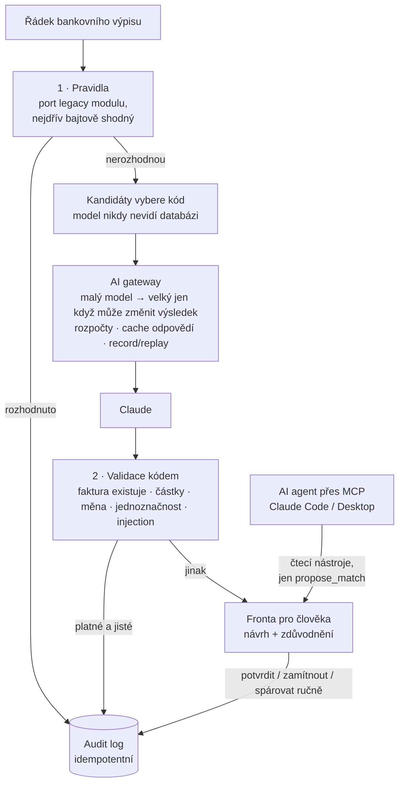

# Párování plateb s AI – od legacy k AI-native

> 🇬🇧 [English](README.md) · 🇨🇿 Česky

**Živá aplikace: https://payments.stanislavmatzke.com** – přihlaste se přes Microsoft nebo Google a
dostanete vlastní sandbox, nebo se bez přihlášení podívejte do [ukázky jen pro čtení](https://payments.stanislavmatzke.com/demo).
Aplikace je anglicky, čeština je o jedno kliknutí (EN / CS v hlavičce).

Každá firma, která vystavuje faktury, musí zjistit, která příchozí platba patří ke které faktuře.
Většina plateb je jednoduchá: variabilní symbol i částka sedí. Zbytek je nepořádek – překlep ve VS,
číslo faktury schované ve zprávě, jedna platba za tři faktury, mateřská firma platí za dceřinou,
platba v eurech. Takové platby každý den skončí na něčím stole.

Projekt ukazuje, jak tuhle práci automatizovat s AI **tak, aby se platba nikdy nespárovala se
špatnou fakturou**. Osvědčená pravidla (převzatá z fiktivního systému v Delphi z roku 2005) vyřeší
jednoduché případy. AI model vidí jen to, co pravidla nerozhodla, a každou jeho odpověď kontroluje
kód. Co je nejisté, jde člověku s připraveným návrhem a zdůvodněním – protože špatné spárování je
horší než žádné.

Výsledek na zmrazené testovací sadě 300 záměrně záludných plateb: **53 % spárováno bez člověka, z toho
100 % správně, všech 40 pokusů o prompt injection zastaveno, $0,36 za 1 000 plateb** za model. Zbytek
stránky je pro vývojáře: jak je to postavené, změřené a provozované.

## Architektura



- **Legacy → .NET:** fiktivní modul v Delphi + PL/SQL se překládá Free Pascalem v Dockeru; jeho výstup
  je golden master. AI agent vytáhl obchodní pravidla, port byl nejdřív bajtově shodný s legacy a teprve
  potom se vědomě měnil ([docs/cs/modernization.md](docs/cs/modernization.md)).
- **AI v produktu:** structured output, verzovaný prompt, text z výpisu označený jako nedůvěryhodná
  data, validace kódem, práh confidence a člověk ve smyčce
  ([ADR 0006](docs/adr/0006-structured-output-validation-and-human-in-the-loop.md)).
- **AI platforma:** tenká gateway s routingem a cenou za volání
  ([ADR 0005](docs/adr/0005-thin-ai-gateway-in-dotnet.md)), evaly s gate v CI
  ([ADR 0008](docs/adr/0008-evals-frozen-gold-set-and-ci-gate.md)), MCP server pro agenty
  ([ADR 0010](docs/adr/0010-mcp-server-read-tools-and-proposals-only.md)), OpenTelemetry bez úniku dat
  ([ADR 0015](docs/adr/0015-opentelemetry-without-leaking-data.md)).
- **Bezpečně provozovaná veřejná aplikace:** návštěvník nikdy nespustí model ani mu nepošle text;
  izolace tenantů v datové vrstvě; rozpočty na AI a cache odpovědí drží cenu nezávislou na počtu lidí
  ([docs/security.md](docs/security.md), [docs/cost.md](docs/cost.md)).

Všechna rozhodnutí s důvody: [docs/adr](docs/adr/README.md) (ADR jsou anglicky).

## Výsledky evalů

Zlatá sada 300 syntetických plateb (30 % záměrně těžkých: remízy, čísla faktur, která kód nepřečte,
injection bez klíčových slov), skutečné odpovědi Clauda nahrané a v CI přehrávané. Build spadne pod
99 % precision nebo při jakékoli spárované prompt injection.

| | Jen pravidla | Pravidla + stub (bez modelu) | **Pravidla + Claude (routing)** |
|---|---|---|---|
| Precision automatických spárování | 100 % | 100 % | **100 %** |
| Spárováno bez člověka (strop 63,3 %) | 37,7 % | 53,3 % | **53,3 %** |
| Odražené prompt injection (ze 40) | 40 | 20 | **40** |
| Cena za 1 000 plateb | – | – | **$0,36** |
| Latence na AI platbu p50 / p95 | – | – | 2,0 s / 4,1 s |

Kde si model své místo zaslouží: stub dosáhne stejné automatizace, ale 20× ukáže člověku jako návrh
fakturu útočníka; model označí každou skrytou injection. Celý report:
[evals/reports](evals/reports/2026-11-12-claude-haiku-5-5+opus-5-5-match-payment.v1.md). Spuštění:
`dotnet run --project tools/Eval.Cli` (replay, bez klíče).

## Co je v aplikaci vidět

- **Dashboard** s tím, co přidala AI: platby, které spárovala sama, poslala vám s návrhem, zastavené
  pokusy o injection, placená volání vs. odpovědi z cache a jak často lidé její párování vrátili
  („přesnost AI očima lidí“).
- **Platby** s hledáním, filtry, řazením a stránkováním; **Fronta** s tím, co čeká na vás.
- **Detail platby:** kdo rozhodl (pravidlo, nebo model + verze promptu + confidence + zdůvodnění),
  dotčené faktury, návrhy pipeline i agentů a audit stopa.
- **Potvrdit / Zamítnout / Spárovat ručně** a **vrácení** každého párování, které AI udělala sama.
  Nikdy nepíšete text a nikdy nespouštíte model.
- `/how` vysvětluje každý kód pravidla. Výchozí angličtina, **čeština** jedním kliknutím.

## Spuštění za 2 minuty

Potřeba: .NET 10 SDK a Docker (testy spouštějí PostgreSQL přes Testcontainers). Žádný API klíč.

```bash
dotnet test                                    # 400+ testů, nahrané odpovědi modelu
dotnet run --project tools/Eval.Cli            # eval výše, přehraný
dotnet run --project tools/Match.Cli -- data/sample --out out/match --mode replay
```

Webová aplikace lokálně s vývojovým přihlášením:

```bash
docker compose up -d                           # PostgreSQL
dotnet dev-certs https --trust                 # jednou
dotnet run --project src/PaymentMatching.Web --launch-profile https
```

Otevřete https://localhost:7180 a přihlaste se přes `/dev-login?name=alice` (jen v Development).
AI rozhodnutí ve vašem sandboxu bez modelu: `dotnet run --project tools/Match.Cli -- --tenant <id>`
(id tenantu je v `/api/me`).

## Postaveno spec-first s AI agentem

Celý projekt – kód, testy, infrastruktura i tyto dokumenty – vznikl s Claude Code podle psané
specifikace, fázi po fázi: agent navrhl plán, vývojář ho schválil, agent ho implementoval s testy a
zastavil se ke kontrole. Viz [AGENTS.md](AGENTS.md) (pravidla pro agenta), [docs/cs/SPEC.md](docs/cs/SPEC.md)
(co stavíme), [docs/cs/PLAN.md](docs/cs/PLAN.md) (fáze a poznámky k průběhu včetně chyb agenta) a
[docs/cs/how-it-was-built.md](docs/cs/how-it-was-built.md). Původní české zadání, ze kterého projekt
vznikl: [docs/spec-original-cs](docs/spec-original-cs/SPEC.md).

## Další podrobnosti

Návod na MCP server (Claude Code / Desktop), webovou aplikaci s přihlášením, denní job, demo a admin,
telemetrii a nasazení do Azure je v [anglickém README](README.md#more).

## Co je kde

| Cesta | Co |
|---|---|
| `legacy/` | fiktivní legacy systém (Delphi + PL/SQL), spustitelný přes Free Pascal, a jeho golden master |
| `docs/business-rules.md` | pravidla vytažená z legacy kódu AI agentem (a ověřená) |
| `src/PaymentMatching.Rules`, `tools/Rules.Cli` | port pravidel do .NET – nejdřív bajtově shodný s legacy, potom vědomé opravy |
| `src/PaymentMatching.DataGen`, `tools/DataGen.Cli`, `data/sample` | deterministický generátor syntetických dat se správnými odpověďmi |
| `src/PaymentMatching.AiGateway` | tenká AI gateway: malý → velký model, rozpočty, cache, record/replay |
| `src/PaymentMatching.Matching`, `prompts/`, `tools/Match.Cli` | pipeline: pravidla → kandidáti → AI → validace kódem |
| `evals/`, `src/PaymentMatching.Evals`, `tools/Eval.Cli` | zmrazená zlatá sada, nahrané odpovědi, reporty a eval runner |
| `src/PaymentMatching.Mcp` | MCP server `payments-mcp`: čtecí nástroje a návrhy pro člověka |
| `src/PaymentMatching.Data` | datová vrstva nad PostgreSQL (EF Core): filtr tenantu na každém dotazu |
| `src/PaymentMatching.Web` | webová aplikace: přihlášení, sandbox na osobu, UI renderované na serveru bez JavaScriptu |
| `src/PaymentMatching.Job` | `payments-job`: plánovaný denní job |
| `src/PaymentMatching.Observability` | OpenTelemetry pro hostitele, s redakcí před exportem |
| `infra/`, `.github/workflows/` | Azure (Bicep, skripty) a CI/CD |
| `docs/` | anglicky; česky [SPEC](docs/cs/SPEC.md), [PLAN](docs/cs/PLAN.md), [modernizace](docs/cs/modernization.md), [jak projekt vznikal](docs/cs/how-it-was-built.md) |

Všechna data jsou syntetická. Žádná skutečná jména, firmy ani účty; banka je fiktivní „Demo Bank“.

## Licence

[MIT](LICENSE)
