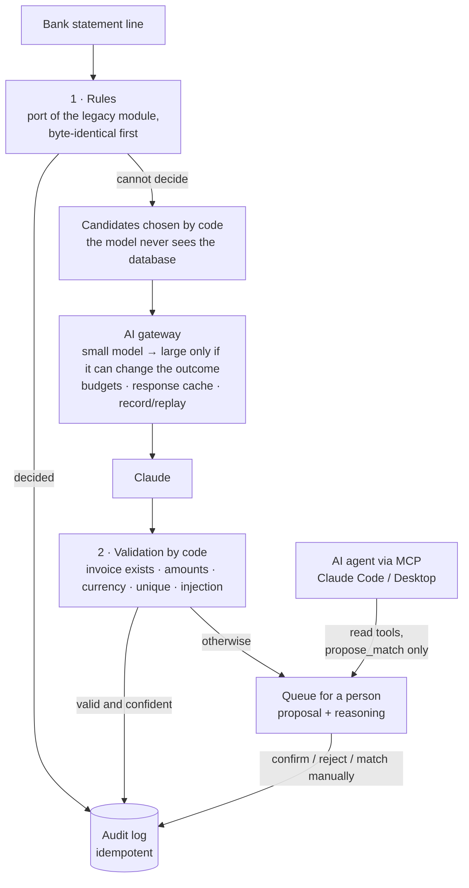

# Payment matching with AI – from legacy to AI-native

> 🇬🇧 English · 🇨🇿 [Česky](README.cs.md)

**Live app: https://payments.stanislavmatzke.com** – sign in with Microsoft or Google and get your own
sandbox, or look around the [read-only demo](https://payments.stanislavmatzke.com/demo) without
signing in.

Every company that issues invoices has to find out which incoming bank payment pays which invoice.
Most payments are easy: the reference number and the amount match. The rest is messy – a typo in the
reference, the invoice number hidden in the message, one payment for three invoices, a parent company
paying for its subsidiary, a payment in euros. Those land on someone's desk, every day.

This project shows how to automate that work with AI **without ever matching a payment to the wrong
invoice**. Proven rules (ported from a fictional 2005 Delphi system) handle the easy cases. An AI
model looks only at what the rules could not decide, and code checks every answer it gives. Whatever
is uncertain goes to a person with a prepared proposal and the reasoning – because a wrong match is
worse than no match.

The result on a frozen test set of 300 deliberately tricky payments: **53 % matched without a person,
100 % of them correct, all 40 prompt-injection attempts stopped, $0.36 per 1,000 payments** for the
model. The rest of this page is for engineers: how it is built, measured and run.

## Architecture



- **Legacy → .NET:** the fictional Delphi + PL/SQL module compiles with Free Pascal in Docker; its
  output is the golden master. An AI agent extracted the business rules, the port was byte-identical
  with legacy first and only then changed on purpose ([docs/modernization.md](docs/modernization.md)).
- **AI in the product:** structured output, a versioned prompt, statement text marked as untrusted
  data, validation by code, a confidence threshold and a person in the loop
  ([ADR 0006](docs/adr/0006-structured-output-validation-and-human-in-the-loop.md)).
- **AI platform:** a thin gateway with routing and cost per call
  ([ADR 0005](docs/adr/0005-thin-ai-gateway-in-dotnet.md)), evals with a gate in CI
  ([ADR 0008](docs/adr/0008-evals-frozen-gold-set-and-ci-gate.md)), an MCP server for agents
  ([ADR 0010](docs/adr/0010-mcp-server-read-tools-and-proposals-only.md)), OpenTelemetry without
  leaking data ([ADR 0015](docs/adr/0015-opentelemetry-without-leaking-data.md)).
- **A public app run safely:** a visitor never starts a model or sends text to one; tenant isolation
  in the data layer; AI budgets and a response cache keep the cost independent of the number of
  people ([docs/security.md](docs/security.md), [docs/cost.md](docs/cost.md)).

All decisions with their reasons: [docs/adr](docs/adr/README.md).

## Eval results

Gold set of 300 synthetic payments (30 % deliberately hard: ties, invoice numbers code cannot parse,
injections without trigger words), real Claude answers recorded and replayed in CI. The build fails
below 99 % precision or on any matched prompt injection.

| | Rules only | Rules + stub (no model) | **Rules + Claude (routing)** |
|---|---|---|---|
| Precision of automatic matches | 100 % | 100 % | **100 %** |
| Matched without a person (ceiling 63.3 %) | 37.7 % | 53.3 % | **53.3 %** |
| Prompt injections defended (of 40) | 40 | 20 | **40** |
| Cost per 1,000 payments | – | – | **$0.36** |
| Latency per AI payment p50 / p95 | – | – | 2.0 s / 4.1 s |

Where the model earns its place: the stub reaches the same automation, but shows the attacker's
invoice to a person as the proposal 20 times; the model flags every hidden injection. Full report:
[evals/reports](evals/reports/2026-11-12-claude-haiku-5-5+opus-5-5-match-payment.v1.md). Run it:
`dotnet run --project tools/Eval.Cli` (replay, no key needed).

## What you see in the app

- **Dashboard** with what the AI added: payments it matched on its own, sent to you with a proposal,
  injection attempts it stopped, paid calls vs. cached answers, and how often people undid its
  matches ("AI precision as people see it").
- **Payments** with search, filters, sorting and paging; **Queue** with what waits for you.
- **Payment detail:** who decided (a rule, or model + prompt version + confidence + reasoning), the
  invoices involved, proposals from the pipeline and from agents, and the audit trail.
- **Confirm / Reject / Match manually**, and **undo** of any match the AI made on its own. You never
  type text and never start a model.
- `/how` explains every rule code. English by default, **Czech** with one click (EN / CS).

## Run it in 2 minutes

Requirements: .NET 10 SDK and Docker (tests start PostgreSQL through Testcontainers). No API key.

```bash
dotnet test                                    # 400+ tests, recorded model answers
dotnet run --project tools/Eval.Cli            # the eval above, replayed
dotnet run --project tools/Match.Cli -- data/sample --out out/match --mode replay
```

The web app locally, with a development sign-in:

```bash
docker compose up -d                           # PostgreSQL
dotnet dev-certs https --trust                 # once
dotnet run --project src/PaymentMatching.Web --launch-profile https
```

Open https://localhost:7180 and sign in with `/dev-login?name=alice` (Development only). To see AI
decisions in your sandbox without a model: `dotnet run --project tools/Match.Cli -- --tenant <id>`
(the tenant id is in `/api/me`).

## Built spec-first with an AI coding agent

The whole project – code, tests, infrastructure and these documents – was built with Claude Code
from a written specification, phase by phase: the agent proposed a plan, the developer approved it,
the agent implemented it with tests and stopped for review. See [AGENTS.md](AGENTS.md) (the rules the
agent follows), [docs/SPEC.md](docs/SPEC.md) (what to build), [docs/PLAN.md](docs/PLAN.md) (phases
and progress notes, including the agent's mistakes) and [docs/how-it-was-built.md](docs/how-it-was-built.md).

## More

<details>
<summary><b>Investigate unmatched payments with an agent (MCP)</b></summary>

`payments-mcp` lets Claude Code, Claude Desktop or any MCP client investigate the payments the
pipeline sent to a person. Four read tools (`list_unmatched`, `get_payment`, `get_customer`,
`search_invoices`) and `propose_match`, which **only queues a proposal** for a person with the
pipeline's validation checks attached. It never matches anything, never calls a model, and returns
bank-statement text only under `untrusted_bank_data`
([ADR 0010](docs/adr/0010-mcp-server-read-tools-and-proposals-only.md)).

1. Run the pipeline once and build the server:

   ```bash
   dotnet run --project tools/Match.Cli -- data/sample --out out/match --mode replay
   dotnet build src/PaymentMatching.Mcp
   ```

2. **Claude Code:** the repository's [`.mcp.json`](.mcp.json) registers the server; start a session
   in the repository and approve `payments`. Without that file:
   `claude mcp add payments -- dotnet run --no-build --project src/PaymentMatching.Mcp -- --data data/sample --state out/match`

   **Claude Desktop:** add to `claude_desktop_config.json` (Settings → Developer → Edit Config), with
   absolute paths, and restart:

   ```json
   {
     "mcpServers": {
       "payments": {
         "command": "dotnet",
         "args": [
           "/path/to/payment-matching-ai/src/PaymentMatching.Mcp/bin/Debug/net10.0/payments-mcp.dll",
           "--data", "/path/to/payment-matching-ai/data/sample",
           "--state", "/path/to/payment-matching-ai/out/match"
         ]
       }
     }
   }
   ```

   **HTTP:** `dotnet run --project src/PaymentMatching.Mcp -- --transport http` (loopback only, no
   authentication) and `claude mcp add --transport http payments http://localhost:5100/mcp`.

3. Ask: *"Use the payments tools to investigate the first 10 unmatched payments and propose matches
   where the evidence is clear."* (also the MCP prompt `investigate_unmatched`). Proposals land in
   `out/match/proposals.jsonl`; restart the server after a new pipeline run.

Over one sandbox of the app database instead: `dotnet run --project src/PaymentMatching.Mcp -- --tenant <id>`
with `ConnectionStrings:Payments` in user-secrets (`--id payment-matching-ai`).
</details>

<details>
<summary><b>The web app: sign-in, sandboxes, the daily job, demo and admin</b></summary>

Every person who signs in gets an own sandbox: a fictional company with this week's starter set of
invoices and 40 payments. Isolation is enforced in the data layer and covered by leak tests
([ADR 0011](docs/adr/0011-tenant-isolation-in-the-data-layer-and-oidc-sign-in.md)). Signing in never
calls a model: the AI decisions for the starter set come from the response cache the job filled
([ADR 0017](docs/adr/0017-instant-ai-for-new-sandboxes-from-a-weekly-starter-set.md)).

**The daily job** `payments-job` ([ADR 0013](docs/adr/0013-ai-cost-model-for-the-hosted-app.md),
[ADR 0014](docs/adr/0014-daily-job-cache-budgets-demo-and-admin.md)) deletes sandboxes unused for 30
days, precomputes the week's starter set, adds one shared daily batch (3–5 payments) to sandboxes in
use and runs rules → AI → validation. Answers are cached by the exact prompt, so the same case in the
next sandbox costs nothing. Budgets: 20 model calls per sandbox and day, 50 a day app-wide and a
monthly dollar cap (then payments go to a person labelled "AI budget used up"). Locally, without a
key and without cost:

```bash
dotnet user-secrets set "ConnectionStrings:Payments" "Host=localhost;Port=5432;Database=payments;Username=payments;Password=local-dev-only" --id payment-matching-ai
dotnet run --project src/PaymentMatching.Job -- --mode stub --migrate
```

`--mode live` calls the real model (needs `Anthropic:ApiKey`) within the same budgets. Settings:
`Ai:Budget:CallsPerSandboxPerDay`, `Ai:Budget:CallsPerDay`, `Ai:Budget:MonthlyUsd`,
`Ai:SmallModelOnly`.

**Demo** (`/demo`): one shared read-only sandbox; set `Demo:TenantId` (any GUID) for the job and the
web app. **Admin** (`/admin`): only for accounts in `Admin:Accounts` (`provider:subject`, e.g.
`dev:boss` locally; yours is `accountId` in `/api/me`); calls, cost, budget, cache hit rate and the
list of accounts – never what is inside a sandbox.

**Sign-in with Microsoft or Google** appears when a client id and secret are configured
(user-secrets locally, never in the repository): register an app in the
[Entra admin center](https://entra.microsoft.com) (personal and organizational accounts, redirect
`https://localhost:7180/signin-microsoft`) or the [Google Cloud console](https://console.cloud.google.com)
(OAuth client, redirect `https://localhost:7180/signin-google`), then set `Auth:Microsoft:ClientId`,
`Auth:Microsoft:ClientSecret`, `Auth:Google:ClientId`, `Auth:Google:ClientSecret`. OpenID Connect
with code flow + PKCE; only provider, account id, name and e-mail are kept (`/privacy`).

The JSON views stay available at `/api/me`, `/api/payments` and `/api/payments/{id}`.
</details>

<details>
<summary><b>Traces and metrics (OpenTelemetry)</b></summary>

Every run can be watched as traces: payment → layer → model call (model, tier, tokens, cost, latency,
cached answer) → outcome, plus metrics for calls, tokens, cost and budget hits. Nothing is exported
unless an endpoint is configured, and telemetry never carries statement text, names, prompts or
model output (tests check it; [ADR 0015](docs/adr/0015-opentelemetry-without-leaking-data.md)).

```bash
docker compose --profile observability up -d
OTEL_EXPORTER_OTLP_ENDPOINT=http://localhost:4317 dotnet run --project tools/Match.Cli -- data/sample --out out/otel --mode replay
```

Then open http://localhost:18888. The same variable works for the web app, the job and the MCP
server. In Azure, `APPLICATIONINSIGHTS_CONNECTION_STRING` sends the same data to Application Insights.
</details>

<details>
<summary><b>Running in Azure</b></summary>

Container Apps (the web app and a daily Container Apps Job), a database on a shared PostgreSQL
Flexible Server, Key Vault, Application Insights; about $3–7 a month for hosting (one always-warm
web replica; ~$0–2 with scale to zero) plus AI within a $0.50 monthly budget
([ADR 0016](docs/adr/0016-azure-hosting-container-apps-shared-postgres-oidc.md),
[docs/cost.md](docs/cost.md)).

**Every push to `main`** deploys after a green CI (`.github/workflows/deploy.yml`): images to
ghcr.io, then the app and the job are pointed at them through OIDC (no password in GitHub), then
smoke tests.

**Infrastructure changes** (Owner on the resource group, from Git Bash or Linux, after `az login`):
`bash infra/deploy-infra.sh` deploys `infra/main.bicep` with the settings in `infra/main.bicepparam`
and keeps the running images. A new environment from scratch, in order:

1. `bash infra/deploy-infra.sh` with `deployApps = false` – identities, Key Vault, monitoring, environment.
2. `TARGET_VAULT=<keyVaultName> bash infra/bootstrap-db.sh` – database, role and the `db-connection` secret.
3. Secrets from your own terminal (read without echo):
   `read -rs KEY && az keyvault secret set --vault-name <keyVaultName> --name anthropic-api-key --value "$KEY" --output none && unset KEY`
   (likewise `microsoft-client-secret`, `google-client-secret`, `admin-accounts` = `provider:subject`).
4. Repository variables `AZURE_CLIENT_ID` (output `deployClientId`), `AZURE_TENANT_ID`,
   `AZURE_SUBSCRIPTION_ID` and a GitHub environment `production`; make the two ghcr.io packages public.
5. `deployApps = true`, `jobEnabled = true` (and client ids, `adminConfigured`) in `main.bicepparam`,
   then `bash infra/deploy-infra.sh` again.
6. Custom domain: CNAME to the web app's FQDN and TXT `asuid.<sub>` = `environmentVerificationId`,
   then `bash infra/bind-domain.sh <domain>` and put the printed values into `main.bicepparam`.

Run the job by hand: `az containerapp job start -g rg-payments -n caj-payments-daily` (live model
calls, within the budgets). After rotating a secret, start a new revision
(`az containerapp update -g rg-payments -n ca-payments-web --revision-suffix <x>`); a running
revision keeps the old value.
</details>

## What is where

| Path | What |
|---|---|
| `legacy/` | fictional legacy system (Delphi + PL/SQL), runnable via Free Pascal, and its golden master – [legacy/README.md](legacy/README.md) |
| `docs/business-rules.md` | rules extracted from the legacy code by an AI agent (and verified) |
| `src/PaymentMatching.Rules`, `tools/Rules.Cli` | .NET port of the rules – byte-identical with legacy first, then deliberate fixes |
| `src/PaymentMatching.DataGen`, `tools/DataGen.Cli`, `data/sample` | deterministic synthetic data generator with ground truth – [docs/data-format.md](docs/data-format.md) |
| `src/PaymentMatching.AiGateway` | thin AI gateway: small → large model, budgets, cache, record/replay |
| `src/PaymentMatching.Matching`, `prompts/`, `tools/Match.Cli` | the pipeline: rules → candidates → AI → validation by code |
| `evals/`, `src/PaymentMatching.Evals`, `tools/Eval.Cli` | frozen gold set, recorded model answers, reports and the eval runner |
| `src/PaymentMatching.Mcp` | MCP server `payments-mcp`: read tools and proposals for a person |
| `src/PaymentMatching.Data` | PostgreSQL data layer (EF Core): tenant filter on every query, decisions, reviews, sandboxes |
| `src/PaymentMatching.Web` | web app: sign-in, one sandbox per person, server-rendered UI without JavaScript |
| `src/PaymentMatching.Job` | `payments-job`: the scheduled daily job |
| `src/PaymentMatching.Observability` | OpenTelemetry for the hosts, with redaction before export |
| `infra/`, `.github/workflows/` | Azure (Bicep, scripts) and CI/CD |
| `docs/` | [SPEC](docs/SPEC.md), [PLAN](docs/PLAN.md), [ADRs](docs/adr/README.md), [modernization](docs/modernization.md), [security](docs/security.md), [cost](docs/cost.md), [how it was built](docs/how-it-was-built.md); Czech versions in [docs/cs](docs/cs) |

All data is synthetic. No real names, companies or accounts; the bank is the fictional "Demo Bank".

## License

[MIT](LICENSE)
